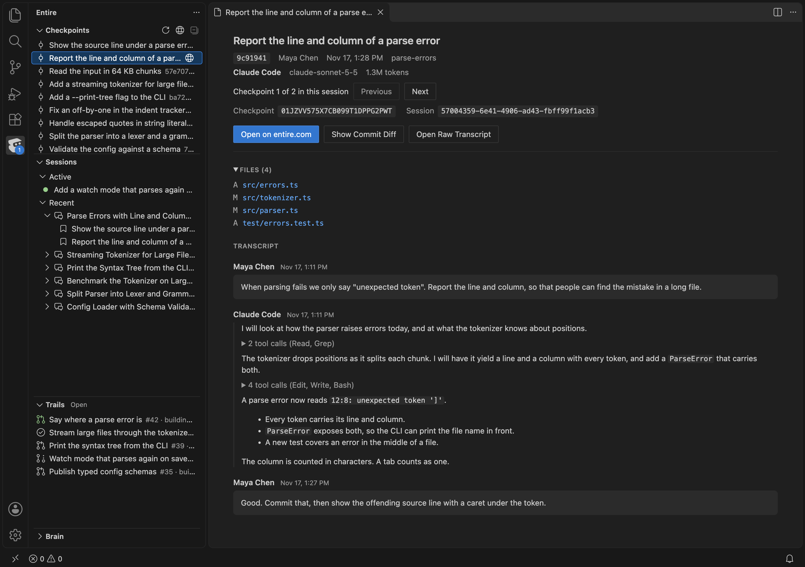
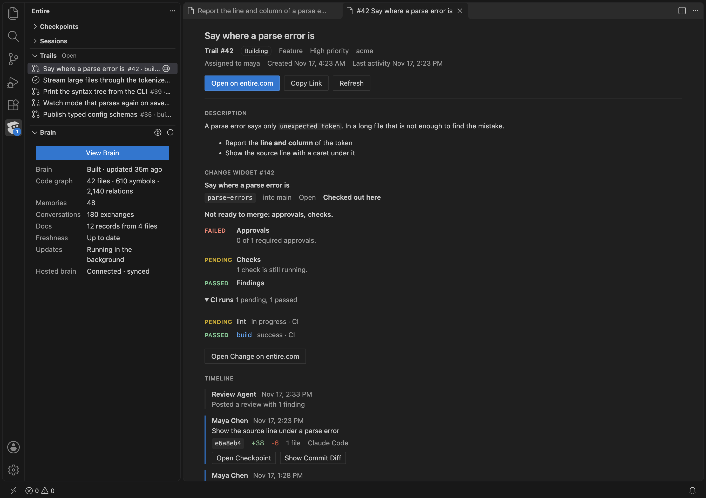

# Entire for VS Code

Browse the [Entire](https://entire.com) checkpoints behind your commits, the agent sessions behind each checkpoint, and the trails of a repository on entire.com, in the editor where you read the code.

## What You Get

**Checkpoints view.** Lists each commit on the current branch that carries an `Entire-Checkpoint` trailer. One session produces a checkpoint for every commit made while it runs, so each row names the agent and says where its checkpoint sits in that session, such as 12 of 249. A commit expands only when there is something to tell apart: several checkpoints, as in a squash, or a checkpoint that holds several sessions. Checkpoints that no commit on the branch carries, such as imported ones, appear under Other Checkpoints. The list shows 50 commits at a time and loads the next 50 when you scroll to its end.

**Sessions view.** Lists the sessions running now, then the rest by recency, each with its checkpoints under it. When the `origin` remote uses the `entire://` scheme, the view reads the repository's sessions from Entire, as the Sessions page of entire.com lists them: every session on every branch, under the name Entire gave it, with Entire's count of its checkpoints. Expanding a session lists the checkpoints your clone knows at once, and adds the ones Entire lists for it, such as those on other branches. In any other repository, a session appears when Entire has local state for it or when a checkpoint references it, and it is named by the prompt that opened it. The view loads 50 sessions at a time in the same way.

**Detail panel.** Click a commit, checkpoint, or session to open it in an editor tab. The panel shows the commit, the files the session touched with a diff for each, and the transcript. Tool calls start collapsed, and expanding one shows its input and result. A checkpoint opens at its own part of the conversation, and Show Earlier Messages loads what came before. The panel says which checkpoint of the session it shows, and Previous and Next step through the session's other checkpoints. The selected row moves with the tab: the view you opened the tab from selects the row of the checkpoint the tab shows, and loads more of its list when that row is beyond the end.

**Trails view.** Appears when the `origin` remote uses the `entire://` scheme. It lists the trails that touch the repository, most recent activity first, 50 at a time. Each row shows the trail's number, its phase, and its branch in this repository, and marks the trail whose branch you have checked out.

A trail is open or closed, and an open trail is in a phase: planning, building, or complete. The filter button in the view's title bar shows only the trails in one of those states: All, Open, Closed, Planning, Building, or Complete. The view starts on Open and names the filter in use beside its title.

**Trail panel.** Click a trail to open it in an editor tab. The panel shows the trail's description and its branches, which Entire calls changes. For a change it shows whether the branch can merge, each merge gate with the reason for its result, and the CI runs on the head commit. Below that is the change's timeline of commits, reviews, and resolved findings. A commit that is in your clone and carries a checkpoint has an Open Checkpoint button, which opens the session behind the commit in the detail panel.

The panel fills in as the Entire CLI answers. It draws the title and status from the Trails view at once, then the changes, then the timeline. A trail you opened earlier in the same window shows from that read at once, and the panel reads it again and redraws what has changed.

**Links to entire.com.** When the `origin` remote uses the `entire://` scheme, each commit, session, and trail gets an Open on entire.com action.

**Search.** Entire: Search opens a picker that searches checkpoints, sessions, and trails as you type. The search button in the title bar of the Checkpoints, Sessions, and Trails views opens it for that view's kind only. Results from what the views have already read appear at once: commit subjects, checkpoint IDs, session names and prompts, agents, and branches. For a repository whose `origin` uses the `entire://` scheme, the picker also asks Entire's search service after you pause typing, and adds the checkpoints, commits, and sessions it ranks, best first, with the part of a session's transcript that matched. Trails have no search command, so the picker reads the repository's trails once, open and closed, and matches their number (`#2923` or `2923`), title, description, phase, and branches. A query can carry Entire's filters, such as `author:alice`, `date:week`, or `branch:main`. The picker applies `branch:` to what the views have read and leaves the others to Entire. Pick a result to open it in the detail panel or the trail panel. Each result has buttons that open it in a new tab or on entire.com.

**Setup view.** The first section of the sidebar while Entire needs a step before the other views can show anything: when the CLI is missing or too old, or when Entire is not enabled in the repository. Entire: Set Up Entire opens it at any time. It lists each step with what it found:

| Step | Done when | Runs |
| --- | --- | --- |
| Entire CLI | The CLI is found and is 0.12.0 or later. | A command from the [installation guide](https://docs.entire.io/installation) that you pick: Homebrew or the install script on macOS, the install script on Linux, PowerShell on Windows. Set Path picks a binary instead. |
| Login | `entire auth status` says you are logged in. | `entire login` |
| Enable Entire | `entire status` says Entire is enabled. | `entire enable` |
| Graph | The Graph plugin is installed, and `.entire/agent-guide.md` tells agents to use it. | `entire plugin install graph`, then `entire graph setup` |
| Brain | The repository has a brain. | `entire plugin install brain`, then `entire brain setup` |
| Brain Connect | The brain is connected to the repository's hosted brain. Listed only when the `origin` remote uses the `entire://` scheme. | `entire brain connect` |

Each button runs its command in a terminal named Entire Setup, where you answer the command's questions: `entire enable` asks which agents to set up, `entire login` opens your browser, and `entire brain setup` asks before it spends tokens. When the command ends, the view checks the step again, and the other views pick up the change without a refresh. The view stays in the sidebar after you use it, so the steps after Enable stay in reach, until you click Hide Setup.

**Brain view.** The last section of the sidebar, shown when Entire is enabled in the repository and collapsed until you open it. It lists what the [entire-brain plugin](https://docs.entire.io/guides/brain/overview) reports about the repository's brain: whether it is built and when it was updated, the size of its code graph, its memories, conversations, and docs, whether it is up to date, whether background updates are running, and whether it is connected to a hosted brain. Anything that needs a look is marked, with the reason on hover. These details are text: only the section's buttons can be clicked.

When the plugin is not installed, or the repository has no brain, the section says so and offers Run in Terminal, which runs the step's command as the Setup view does, and Copy Command.

The View Brain button starts the plugin's graph page for the repository and opens it in your browser. The page draws the code entities in the brain and the calls and imports between them. The same button is in the section's title bar, and the command palette has Entire: View Brain. While the page's server runs, the section says where and has a Stop button. Closing the window stops it too.

## Requirements

- [Entire CLI](https://docs.entire.io/installation) 0.12.0 or later. The extension reads checkpoints and sessions through it. The Setup view can install it.
- Git.
- A local repository with Entire enabled (`entire enable`), opened as a trusted workspace. The Setup view can enable it.
- For the Brain view, the entire-brain plugin (`entire plugin install brain`) and a brain for the repository (`entire brain setup`).
- For the Trails view, an `entire://` origin and a login saved with `entire login`. Trails are stored on Entire, not in the clone, so the view lists them whether or not Entire is enabled there.
- For session names from Entire, the same origin and login. Without them, the Sessions view names each session by its opening prompt.
- For results from Entire's search, the same origin and login. Without them, Search matches what the views have read.

The extension looks for `entire` on your `PATH`, then in `~/.local/bin`, `/opt/homebrew/bin`, and `/usr/local/bin`, and then asks your login shell. Set `entire.cliPath` if the binary lives somewhere else.

## Getting Started

1. Install Entire from the Extensions view in VS Code, Cursor, or another editor that installs from Open VSX.
2. Open your repository and select the Entire icon in the activity bar.
3. Follow the Setup view, which lists what is missing and runs each step in a terminal. If you set Entire up from a terminal already, the views show your checkpoints and sessions.

## Settings

| Setting | Default | Purpose |
| --- | --- | --- |
| `entire.cliPath` | empty | Absolute path to the Entire CLI binary. |
| `entire.loadOnScroll` | `true` | Load the next 50 rows of a list when you scroll to its end. When off, click Load More. |
| `entire.search.hosted` | `true` | Also search with Entire's search service, for a repository whose `origin` remote uses the `entire://` scheme. When off, Search matches what the views have read and runs no `entire search` command. |
| `entire.trails.enabled` | `true` | Show the Trails view and read trails from Entire. When off, the view is hidden and the extension runs no `entire trail` command. |
| `entire.webBaseUrl` | empty | Base URL for links to the Entire web app. When empty, the extension uses `ENTIRE_WEB_BASE_URL` if it is set, and `https://entire.com` otherwise. |

## What the Extension Runs

The extension reads. It does not create, edit, or delete checkpoints. The commands that set Entire up, such as `entire enable` and `entire brain setup`, run only when you click a step in the Setup view or Run in Terminal in the Brain view, and they run in a terminal you can see. It runs these commands in your repository:

| Command | When |
| --- | --- |
| `git log`, `git cat-file`, `git for-each-ref`, `git diff-tree` | To list commits, read stored transcripts, and build diffs. |
| `entire status --json` | On load and on each automatic refresh. |
| `entire checkpoint explain --json` | In the background, to add each checkpoint's agent and sessions to the views. |
| `entire checkpoint explain --checkpoint <id>` | When you expand or open a checkpoint. |
| `entire checkpoint explain --checkpoint <id> --short` | When you open a checkpoint that no commit in the history read so far carries, to learn who its author is. Once for each such checkpoint. |
| `entire session list --json` | When the Sessions view is first shown, and when you click Refresh. |
| `entire api --to cell /api/v1/repos/{repo_id}/sessions?scope=all&limit=50` | When the Sessions view is first shown, when its list loads the next page, and when you click Refresh. Only for an `entire://` origin. |
| `entire api --to cell /api/v1/repos/{repo_id}/sessions/<session>/transcript` | When you expand or open a session for which Entire counts more checkpoints than your clone knows. Once for each such session, until you click Refresh. |
| `entire trail list --json` | When the Trails view is first shown, when you change the filter to another status, when the list loads its next page, and when you click Refresh. Also once for each search that covers trails, for up to four pages of 50. |
| `entire trail show <trail> --json` | When you open or refresh a trail, and the first time you open or copy a trail's link from its row. |
| `entire trail timeline <trail> --json` | When you open or refresh a trail, switch to another of its changes, or load more of its timeline. Opening a trail runs it once or twice: the panel asks for the trail's timeline while it reads the trail, and asks again for one change by name when the trail has several changes or a change whose branch is gone. |
| `entire brain status --json` | When the Brain view is first opened, when you click Refresh after that, and when you open the brain graph. Also when the Setup view comes on screen, and after a setup step ends. |
| `entire search --json --limit 25 -- <query>` | When you pause typing in Search, for each repository whose `origin` uses the `entire://` scheme. |
| `entire auth status --json` | When the Setup view comes on screen, when you click Check Again, and after a setup step ends. |
| `entire graph version --json` | At the same times as `entire auth status`, to learn whether the Graph plugin is installed. |
| `entire brain viz --no-open --port 0` | When you open the brain graph and its server is not running for the repository. The plugin serves the page on 127.0.0.1 until you stop it or close the window. |

Two of these have effects inside the Entire CLI. `entire checkpoint explain` fetches checkpoint data from your checkpoint remote when it is missing from the local clone. `entire session list` removes session state that has been idle for more than seven days, which is why the extension keeps it out of automatic refresh.

The extension sends no network requests of its own. The three trail commands, the two `entire api` calls, and `entire search` make the Entire CLI read Entire over the network with your saved login. The extension runs them only for a repository whose `origin` uses the `entire://` scheme, and not before the view that needs them is on screen or you search. `entire auth status` asks Entire about your saved login, and runs only while the Setup view is on screen or after a setup step. Turn off the `entire.search.hosted` setting to stop the extension from running `entire search`. Turn off the `entire.trails.enabled` setting to hide the Trails view and stop the extension from running the trail commands. It runs none of the trail commands that write, such as `entire trail approve` or `entire trail merge`.

`entire api` is the CLI's authenticated request to Entire's API. The extension gives it a path and nothing else, which makes it a GET: it passes no method, field, or body. The CLI calls these endpoints internal and says their shape can change without notice. When a read fails, or returns something the extension does not recognize, the Sessions view shows what your clone knows, with each session named by its opening prompt.

The brain graph is served on your machine by the entire-brain plugin, on the loopback address. The plugin describes the page as read-only, with no outbound network. The extension opens only that local address.

Open Raw Transcript has the Entire CLI write the transcript to a file in a private temporary directory, opens it read-only, and removes it when the window closes. A raw transcript can run to hundreds of megabytes, so it goes to a file instead of through memory.

## Limits

- The Checkpoints view follows the history of `HEAD`. Other branches appear after you check them out.
- Loading on scroll pauses when it reads 20,000 commits without finding a checkpoint. Click Load More Checkpoints to read further back.
- A commit can name a checkpoint whose session data was never uploaded. The commit carries the checkpoint's ID, and the Entire CLI uploads the data separately. Opening one shows the commit and its diff with a note in place of the transcript, and its row then reads "no session data".
- A session with no checkpoint yet shows its facts and its raw transcript, with no chat view.
- The selected row follows a tab only in the view the tab was opened from, and only while that view is on screen. The other view keeps its own selection. A tab opened from a trail is followed by the Checkpoints view. A tab opened on a session's own row has no Previous and Next, so its selection stays on the session.
- Session names come from Entire only for an `entire://` origin and a saved login. The view reads them when it is first shown and when you click Refresh, and it does not follow changes on Entire in between. A session that Entire has not listed yet, such as one that is still running, is named as in any other repository until then.
- Without Entire's list, a session's name is read from the start of the normalized transcript that its checkpoints store. A session with no checkpoint shows its latest prompt in its place. A session whose checkpoints store no normalized transcript, as some Codex sessions do not, shows the message of its newest checkpoint until you open it, and its opening prompt after that.
- Entire's count of a session's checkpoints can be higher than the number its page on entire.com lists. In testing, a session counted at 36 listed 29. A session's row shows the count until you expand it, and the number of checkpoints listed after that.
- Entire sends a session's checkpoints with its transcript. In testing that took two to eight seconds, so the checkpoints your clone knows show first and the rest are added when they arrive.
- Entire can list a checkpoint whose session data the Entire CLI cannot find in your clone or on the checkpoint remote. Opening one shows a note in place of the transcript, and Open on entire.com shows the session there.
- A transcript does not record who sent its prompts. The panel names the author of the commit that carries the checkpoint, as the Entire CLI does. For a checkpoint with no commit in the history read so far, it names the author the CLI reports, which arrives a moment after the transcript. A prompt reads "User" when neither is known.
- The chat view reads the normalized transcript that Entire stores in each checkpoint. A session without one falls back to the Entire CLI's text view, which omits tool inputs and results and covers the latest session of a checkpoint.
- The agent on a commit row, a checkpoint's place in its session, and the checkpointed sessions in the Sessions view come from the Entire CLI, which reports the newest 500 commits of the current branch. Older commits show commit details until you open them. A plus sign, as in 210+, marks a session at the old end of that list, which may have earlier checkpoints.
- Links to entire.com need an `entire://` origin. A repository connected to Entire through the GitHub App with a `github.com` origin gets no links and no Trails view.
- The Trails view lists the trails that touch the repository of the `origin` remote. It reads them when it is first shown and when you click Refresh, and it does not follow changes on Entire in between.
- The Entire CLI lists trails by status and not by phase. For the Planning, Building, and Complete filters, the extension reads the open trails and keeps the ones in that phase, at most four pages of 50 for each load. It cannot know how many trails in the phase are left, so the Load More row says how many trails it has read, as in 10 shown · 200 of 1,240 read.
- The Trails view and the trail panel are read-only. Change a trail's status, comment on it, review it, approve it, and merge it on entire.com or with the Entire CLI.
- In testing, the Entire CLI took about one second to read a trail and two to three seconds to read a timeline, whatever the page size. The trail panel reads both at once and draws each when it arrives. The timeline of a change whose branch is gone, such as a merged branch that was deleted, takes about a second longer, because the CLI finds that change only by a number that the trail has to supply first.
- The brain graph opens in your browser, not in an editor tab. The plugin's page forbids other pages from embedding it.
- The Brain view reads the brain when you first open it and when you click Refresh. It does not follow the brain's changes in between.
- The brain graph's server keeps its port until you run Entire: Stop Brain Graph or close the window. It reads the checked-out branch when it starts, so the extension starts it again when you open the graph on another branch.
- The extension installs a plugin, builds a brain, or connects one only when you click a step, and it refreshes no brain.
- A setup step learns that its command ended from the terminal's shell integration. In a shell without it, the step shows as running until you come back to the window, close the terminal, or click Check Again.
- The Graph step counts as done when `.entire/agent-guide.md` mentions `entire graph`, which is what `entire graph setup` writes. It does not check the references in AGENTS.md and CLAUDE.md.
- While you type, the picker lists the results whose title contains your query first, and hides its section headings. Each result says what kind it is in its description.
- Search matches only what the views have read. A commit older than the history the Checkpoints view has scanned, or a session the Sessions view has not listed, appears only when Entire's search finds it.
- Entire's search returns checkpoints, commits, and sessions. A session that only Entire knows opens at the checkpoint whose transcript matched.
- The trail panel shows the timeline of one change at a time. A commit in it opens its checkpoint only when the commit is in your clone, so fetch the trail's branch to open the rest. For a change in another repository of the project, the panel lists the commits and opens none of them.

## Feedback

Report a problem or ask for a feature in the [issue tracker](https://github.com/entireio/entire-vscode/issues). [CONTRIBUTING.md](CONTRIBUTING.md) covers building and testing the extension. Report a security vulnerability the way [SECURITY.md](SECURITY.md) says, and not in an issue.

## License

[MIT](LICENSE). [THIRD_PARTY_NOTICES.md](THIRD_PARTY_NOTICES.md) lists the code from other projects that ships inside the extension.
